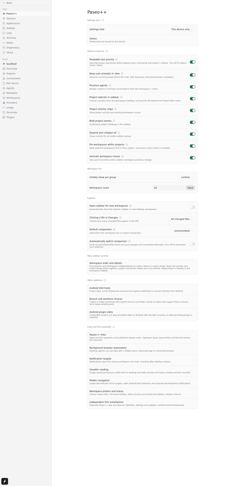

<!-- fork-overview:start -->

# Paseo++

Paseo++ is [RyanEwen/paseo-plus-plus](https://github.com/RyanEwen/paseo-plus-plus), an experimental fork of [Paseo](https://github.com/getpaseo/paseo). It includes upstream improvements alongside the features and fixes below.

For fork development and integration, follow the [worktree guide](docs/worktree-development.md#fork-branches-and-ownership). Published builds follow the [fork release process](docs/release.md#fork-preview-distribution).



## Optional features

All switches in **Optional features** start enabled. Display preferences have independent defaults; **Expand one project at a time** starts off. The settings button opens **Paseo++** first, where you can find their switches. Turning a feature off preserves its saved data and preferences.

### Keep user prompts in view

User messages start collapsed to one line and the actual message row sticks when it reaches the top. More… expands the full message and attachments in place; long expanded bodies scroll while Less… and navigation stay reachable. Click a pinned message to return to its original position, or use the arrows to move between pinned prompts without moving the controls. Newer messages push the preceding pinned row away. Navigation arrows sit beside copy and rewind controls, appearing on hover on desktop and staying visible on touch screens. After arrow navigation, the destination’s controls stay visible until you move the mouse. Jump to latest sits above the composer’s right edge.

### Readable tool activity

See clearer descriptions of reading, editing, creating, searching and running scripts across compatible providers. Running, failed and canceled operations keep their status, and full commands, output and multi-file changes remain expandable. Turn this off to restore classic labels and grouping.

[View example](packages/app/assets/settings-examples/annotated/descriptiveToolCalls-descriptive-tool-calls.svg)

### Previous agents

Reopen conversations with closed tabs or archived agents from the workspace **+** menu. Return to the same conversation, then choose **Unarchive** when you want to resume an archived agent.

[View example](packages/app/assets/settings-examples/annotated/previousAgents-previous-agents.svg)

### Project selector

The **Selected project in heading** switch shows the selected project name in the workspace heading. Off uses **Workspaces**; host and project choices remain available. The chooser lists projects directly, with **Hosts** shown when multiple hosts are available. Click a project name to show only that project, or use checkboxes to include several. **All** clears both local filters.

The workspace heading, project selector, and display controls stay visible while you scroll the workspace list. Desktop expand and collapse controls stay with the heading.

[View example](packages/app/assets/settings-examples/annotated/sidebarProjectSelector-project-selector.svg)

### Project activity chips

See whether a project's workspaces are working, need input, or have finished. When several workspaces are working, the chip shows their count. Project choices in the dropdown show the same badges, including when another project is selected.

[View example](packages/app/assets/settings-examples/annotated/sidebarActivityChips-project-header.svg)

### Bold project names

Make project headings easier to distinguish from workspace rows.

[View example](packages/app/assets/settings-examples/annotated/sidebarProjectEmphasis-project-header.svg)

### Expand and collapse all

Expand or collapse visible sidebar groups together while retaining hidden groups' preferences.

[View example](packages/app/assets/settings-examples/annotated/sidebarBulkActions-bulk-actions.svg)

### Pin workspaces within projects

Keep selected workspaces at the top of their project, alongside the existing option to pin at the top of the whole sidebar. Project-pinned workspaces show a pin in the gutter to the left of their name. The marker uses the existing gutter without shifting workspace names; project icons and operation loaders retain their place. A global sidebar pin alone does not show this project-pin marker. Turning the feature off hides the marker; saved project pins return when it is re-enabled.

[View example](packages/app/assets/settings-examples/annotated/projectPinning-project-pin.svg)

### Animate workspace moves

Follow workspaces as status changes or expanding and collapsing projects move them to new positions with quick transitions. Animations respect reduced-motion preferences and preserve collapsed groups and display limits.

### Automatic Android update checks

Check for published Paseo++ releases on startup and resume. Available updates appear in the sidebar. Follow download progress and verification in the sidebar or Settings, then approve installation in Android. Turning automatic checks off keeps manual checking and installation available.

### Sidebar host updates

Update a host from the sidebar when it confirms update support and a compatible release is available. Older hosts can use the manual update flow without a release-availability check. This sidebar action starts enabled; turn **Host updates in the sidebar** off in Paseo++ settings to hide it while keeping the ordinary update action in Host Settings.

## Display and reading preferences

### Tool call display

New preferences start in **Summary**. Choose **Full detail** in **Settings → Chat**; saved choices are preserved.

### Workspace tab widths

Desktop tabs have a 96 px minimum width, so short names such as Dev stay comfortable to select. The strip scrolls when the available space cannot fit that minimum. Compact tabs retain their existing larger touch layout.

### Split layout controls

Use the split icon beside a creation item in the workspace **+** menu, then click the region where the new view belongs. One set of diagrams splits left/right and another splits top/bottom. In a 60/40 diagram, clicking left or top gives the new pane 60%; clicking right or bottom gives it 40%. Clicking the creation item itself keeps its normal behavior.

Right-click a tab and choose **Move tab** to move that same tab to an existing pane or a region in a split diagram. Compact diagrams use larger touch regions and wrap within the scrolling menu. Keyboard users can move through the region choices with Up/Down, Home/End, then Enter or Space.

Hover a workspace divider to choose 50/50, 60/40, 40/60, 70/30, or 30/70 proportions for its existing adjacent panes. Divider choices resize panes; they do not create or move a tab. Turn **Split layout controls** off in Paseo++ settings to hide these controls without changing your layout.

### Mobile workspace tabs

Switch between workspace tabs directly on your phone with the tab strip enabled by default. Scroll it horizontally, use each tab's actions for renaming or closing, and open another tab from **+**. Turn **Mobile workspace tabs** off in Paseo++ settings to restore the earlier chooser while preserving your selected tab and drafts.

### Accent colors

Choose an accent color in Appearance for primary controls and your messages, including pinned prompts. Colors adapt to light and dark themes; Default restores your theme’s original appearance. If you sync settings, update the selected settings host to enable this preference.

### Sidebar display options

Workspace hover details wait 250 ms before opening. Moving away cancels the popup before its content mounts. Keyboard activation stays immediate.

In Project mode, enable **Display → Expand one project at a time** to collapse other known project groups when you expand one. It starts off. Pinned and Status groups retain their existing behavior; **Expand all** still expands all visible groups.

Switch between Project and Status views with the bell beside the workspace heading. Each view keeps its own Display preferences and device-local host/project filters. Display includes sorting, labels, background workspaces, row details and activity. **Show background workspaces** reveals workspaces explicitly created for background work, which are normally hidden; it does not mean every workspace you are not currently viewing. Background visibility is retained across app reloads and reconnects. Project labels start visible; branch labels start hidden. A selected settings host must support separate sidebar modes before these synchronized controls can be edited.

The workspace chooser lists projects directly. With multiple hosts, its **Hosts** submenu filters them; projects from the selected hosts appear directly below it. Adding a project includes it in your current project selection. Host and label filters remain independent.

Dragging is available only when the applicable project or workspace sort is **Custom**; it never changes the sort mode. Sorted workspace rows remain selectable and their action menus stay available. A filtered project move stays before or after the same anchor project when **All** is shown, preserving the relative order of other projects. Pinned workspaces retain independent manual ordering. Project status sorting places **Done** before **No status**.

The filter icon beside the bell opens a quick text filter for the current mode. Match project or workspace names, titles and visible branches without changing the active workspace, saved order or sort. Project-name matches retain their scoped children; other matches retain the matching workspace and its project. Each mode keeps its own text for the current app session. Clear, close or press Escape to restore the list; collapsed sections keep their existing state.

In **Display → Empty projects**, choose **Show**, **Group**, or **Hide** for project groups with no visible workspaces.

In **Display → Workspace limits**, open **Count limit** or **Updated within** to choose each view’s limits independently. The count defaults to 20 and the age limit to All. Quick text matching runs before the count window, so a match beyond the first 20 can still appear. **Show more** reveals every matching workspace in that group, including older entries.

### Explorer and Changes

Choose whether Explorer starts open in new desktop workspaces and whether opening a changed file shows its own diff or all changed files. Set a default comparison, or automatically switch between Uncommitted when dirty and Committed when clean. Changes remembers each workspace's comparison across reloads. Find these preferences in **Settings → Paseo++**.

## Other additions

### Sync app settings

Choose a settings host in Paseo++ on Android or desktop to share preferences across your clients, including whether Usage appears in the sidebar. Switching hosts loads their saved settings first; an empty host requires an explicit publish action. Connection details, project filters, workspace order and collapsed groups stay local. Your settings host needs a daemon build with settings sync support. Shared settings refresh when the connection’s write permission changes. Retry recovers failed initial reads without leaving editing disabled. Read-only connections can retry the read without restarting the app or replacing saved preferences.

### Android SSH hosts

Connect directly to a remote daemon using an imported private key and optional passphrase, without requiring the Paseo relay. Verify the server fingerprint before connecting; saved credentials are encrypted on your phone. Setup can be dismissed safely during imports and checks.

### Branch and worktree choices

Create a workspace from an existing branch or a new one, with shared or separate branch and folder names. Adopt an existing checkout without creating another worktree, preserving its working subdirectory. Retry failed setup without losing the checkout already created for it.

### Android plugin video

Compatible plugins can display encoded video in workspace panels and recover playback after decoder errors. A plugin that supplies video is required.

### Standalone Linux and WSL daemons

Run a standalone Paseo++ daemon alongside upstream Paseo with separate settings, host identity, agents, and workspaces. Use the app's host **Update** action to receive published fork releases. See [installation instructions](#standalone-daemon-linux-and-wsl) below.

## Fixes and fork essentials

### Paseo++ links

Open the fork repository and published release notes from the app. Upstream issue, sponsorship, and Discord actions are removed.

### Workspace browser links

On desktop, HTTP and HTTPS links from workspace chat open in a Paseo browser tab by default. Turn **Open chat links in Paseo** off in Paseo++ settings to open primary clicks externally; **Open in Paseo browser** remains available in the link menu. When enabled, right-click a link to choose your external browser. Workspace repository, pull request, check, and Markdown links also offer **Open in Paseo browser**, while their usual action stays the same.

Mobile and browser clients, and links outside a workspace, continue opening links externally.

### Background browser automation

Desktop agents can interact with browser tabs while the pane is hidden, the app is unfocused, or its window is minimized.

### Codex async questions

Unanswered questions stay available when a Codex turn is stopped or interrupted. You can answer or dismiss them later, including after reopening the conversation.

### Notification targets

Chat notifications open their owning workspace, including older notifications without a workspace link. Windows banners and Notification Center entries retain their chat targets across app restarts.

### Steadier reading

Visible text on desktop and web stays in place when an image finishes loading at a shorter height. Prompt and history loading recover from failures without leaving navigation stuck.

### Mobile navigation

Use a larger tab-switcher touch target. Android Back returns from a workspace to the workspace list, and development and production apps keep notification delivery separate.

### Workspace pickers and status

Host, project, checkout, and branch choices follow the setup order and include explanations. Hover over truncated choices to see full values. Projects remain available when workspaces are pinned. Status sorting puts the newest workspaces first within each status; row actions and hover details accommodate statuses, branch names, and worktree paths.

### Independent fork installations

Paseo++ apps and daemons keep separate identities, settings, and update sources from upstream Paseo. Set up hosts and preferences independently in each installation.

## Install Paseo++

Download desktop and Android builds from [Paseo++ releases](https://github.com/RyanEwen/paseo-plus-plus/releases). New builds discover updates from this repository directly. The legacy repository redirect remains available for existing installations. Builds are available for Windows and Linux (x64 and ARM64), plus Android. Windows and Linux AppImage builds receive updates from Paseo++ releases. The desktop app includes its own daemon. macOS is deferred until Apple signing is available; iOS and hosted web are excluded. The upstream overview farther down retains upstream download links and installation commands.

The planned transition to normal releases needs one final prerelease updater bridge for older Android apps and standalone hosts. That bridge has not been published by this change. The [release transition](docs/release.md#final-prerelease-bridge-and-normal-latest-releases) owns qualification, publication and bridge retention requirements.

Paseo++ desktop and Android apps keep their own settings and identities, separate from upstream Paseo. Set up your hosts and preferences independently in each app. The desktop app also keeps its bundled daemon in `~/.paseo-plus-plus-desktop` on port 6790, separate from the standalone daemon. Desktop and Android previews use fresh Paseo++ installations and settings; set up connections again when moving from the former Debug builds.

### Standalone daemon (Linux and WSL)

Install Node.js 22 or newer and at least one agent CLI. Download the matching `paseo-daemon-<version>-linux-<arch>.tgz` from [Paseo++ releases](https://github.com/RyanEwen/paseo-plus-plus/releases). Use `x64` for Intel/AMD or `arm64` for ARM. Linux packages require glibc; Alpine/musl is unsupported.

Install the downloaded package, then start the daemon:

```bash
npm install -g ./paseo-daemon-<version>-linux-<arch>.tgz
paseo-plus-plus daemon run
```

Keep that terminal open, or use `paseo-plus-plus daemon run` as your service's command. The standalone daemon keeps its settings, host identity, agents, and workspaces in `~/.paseo-plus-plus` and listens on `127.0.0.1:6791`. Upstream Paseo and Paseo++ can run side by side with their defaults. Set up the new daemon independently and connect your app to it. These defaults apply to previews built with the `paseo-plus-plus` command.

Use **Update** next to a host in the sidebar footer's hosts list to install a newer eligible daemon release. The action appears when the host confirms that its installation supports updating and a compatible release is available. Older hosts keep their Settings update action. Source-built daemons need to switch to a release package to use this update path.

<!-- fork-overview:end -->

---

<p align="center">
  
</p>

<h1 align="center">Upstream Paseo</h1>

<p align="center">
  <a href="README.md">English</a> ·
  <a href="README.zh-CN.md">简体中文</a> ·
  <a href="README.ja.md">日本語</a> ·
  <a href="README.ko.md">한국어</a>
</p>

<p align="center">
  <a href="https://github.com/getpaseo/paseo/stargazers">
    
  </a>
  <a href="https://github.com/getpaseo/paseo/releases">
    
  </a>
  <a href="https://x.com/moboudra">
    
  </a>
  <a href="https://discord.gg/jz8T2uahpH">
    
  </a>
  <a href="https://www.reddit.com/r/PaseoAI/">
    
  </a>
</p>

<p align="center">One interface for Claude Code, Codex, Copilot, OpenCode, Pi, Antigravity, and Muse Code agents.</p>

<p align="center">
  
</p>

<p align="center">
  
</p>

Paseo is an open source agentic development environment for desktop, mobile, web, and CLI. Open the desktop app and work: agents, editor, terminals, diffs, pull requests, and a browser in one window. Run many agents at once, each in its own worktree, on one machine or several. The mobile app is the full app, native on iOS and Android.

- **Parallel agents:** Run many agents at once, each in its own worktree.
- **Built-in orchestration:** Agents in Paseo can create worktrees, launch other agents, and talk to them, across providers.
- **Complete development workflow:** Edit files, review diffs, open pull requests, and run terminals, in split panes you arrange how you want.
- **Self-hosted:** Agents run on your machine with your full dev environment. Use your tools, your configs, and your skills.
- **Multi-provider:** Claude Code, Codex, Copilot, OpenCode, Pi, Antigravity, and Muse Code through the same interface. Pick the right model for each job.
- **Voice control:** Dictate tasks or talk through problems in voice mode. Hands-free when you need it.
- **Cross-device:** iOS, Android, desktop, web, and CLI. Start work at your desk, check in from your phone, script it from the terminal.
- **Privacy-first:** Paseo doesn't have any telemetry, tracking, or forced log-ins.

[Run parallel tasks in Paseo](https://paseo.sh/docs/parallel-development): start agents in separate worktrees, review their diffs, run each app, and check it in the built-in browser.

## Plugins

Plugins run on the daemon and show up in every client you connect, with the same UI on desktop, web,
iOS, and Android. Write a plugin once and it is on your phone.

- **UI:** screens, sidebar items, workspace panels, Command Center items, slash commands, composer pills, attachment sources, timeline items, themes.
- **Agent lifecycle:** change configuration, environment, and MCP servers, answer permissions, follow up when a turn ends.
- **Providers:** add a coding agent as a provider.

Install from the registry with `paseo plugin add owner/slug`, or from Git or a local directory.

**[Browse plugins](https://paseo.sh/plugins)** · **[Plugin docs](https://paseo.sh/docs/plugins)**

Plugins run with access to your daemon machine and inside connected clients; install only code you trust.

## Getting Started

Paseo runs a local server called the daemon that manages your coding agents. Clients like the desktop app, mobile app, web app, and CLI connect to it.

### Prerequisites

You need at least one agent CLI installed and configured with your credentials:

- [Claude Code](https://docs.anthropic.com/en/docs/claude-code)
- [Codex](https://github.com/openai/codex)
- [GitHub Copilot](https://github.com/features/copilot/cli/)
- [OpenCode](https://github.com/anomalyco/opencode)
- [Pi](https://pi.dev)
- [Antigravity](https://paseo.sh/docs/supported-providers#antigravity)
- [Muse Code](https://paseo.sh/docs/muse-code)

### Desktop app (recommended)

Download it from [paseo.sh/download](https://paseo.sh/download) or the [GitHub releases page](https://github.com/getpaseo/paseo/releases). Open the app and the daemon starts automatically. Nothing else to install.

To connect from your phone, open **Settings → your host → Pair Device**.

### Server

For a server, a VM, or any machine without the desktop app. Install the CLI and start the daemon:

```bash
npm install -g @getpaseo/cli
paseo
```

Paseo starts, then asks whether to enable the end-to-end encrypted relay for device pairing. If you decline, connect directly over TCP, Tailscale, or another VPN. The desktop, mobile, and web apps connect to this daemon like any other host.

For full setup and configuration, see:

- [Docs](https://paseo.sh/docs)
- [Connectivity guide](https://paseo.sh/docs/connectivity)
- [Configuration reference](https://paseo.sh/docs/configuration)

### Docker

Run the Paseo daemon and self-hosted web UI in Docker:

```bash
docker run -d --name paseo \
  -p 6767:6767 \
  -e PASEO_PASSWORD=change-me \
  -v "$PWD/paseo-home:/home/paseo" \
  -v "$PWD:/workspace" \
  ghcr.io/getpaseo/paseo:latest
```

Open `http://localhost:6767` after it starts. Extend the base image with the agent CLIs you use, then provide credentials through environment variables or the persistent `/home/paseo` volume. See the [Docker documentation](docs/docker.md) for full setup details.

## CLI

Everything you can do in the app, you can do from the terminal.

```bash
paseo run --provider claude/opus-4.6 "implement user authentication"
paseo run --provider codex/gpt-5.5 --worktree feature-x "implement feature X"

paseo ls                           # list running agents
paseo attach abc123                # stream live output
paseo send abc123 "also add tests" # follow-up task

# run on a remote daemon; --cwd is a path on that host
paseo run --host workstation.local:6767 --cwd /workspace "run the full test suite"
```

See the [full CLI reference](https://paseo.sh/docs/cli) for more.

## TypeScript SDK

Build issue integrations, dashboards, and orchestration services with `@getpaseo/client`:

```ts
import { createPaseoClient } from "@getpaseo/client";

const client = createPaseoClient({ url: "ws://127.0.0.1:6767/ws" });
await client.connect();

const agent = await client.agents.create({
  config: { provider: "codex/gpt-5.5" },
  cwd: "/Users/me/dev/storefront",
  prompt: "Review the current diff and name the riskiest change.",
});

const result = await agent.waitForFinish();
console.log(result.lastMessage);

await client.close();
```

See the [SDK quickstart](https://paseo.sh/docs/sdk/quickstart), [recipes](https://paseo.sh/docs/sdk/recipes), and [API reference](https://paseo.sh/docs/sdk/reference).

## Skills

Skills teach your agent to use Paseo to orchestrate other agents.

```bash
npx skills add getpaseo/paseo
```

Then use them in any agent conversation:

- `/paseo-handoff` — hand off work between agents. I use this to plan with Claude and then handoff to Codex to implement.
- `/paseo-advisor` — spin up a single agent as an advisor for a second opinion, without delegating the work itself.
- `/paseo-committee` — form a committee of two contrasting agents to step back, do root cause analysis, and produce a plan.

## Development

Quick monorepo package map:

- `packages/server`: Paseo daemon (agent process orchestration, WebSocket API, MCP server)
- `packages/app`: Expo client (iOS, Android, web)
- `packages/cli`: `paseo` CLI for daemon and agent workflows
- `packages/desktop`: Electron desktop app
- `packages/relay`: Relay transport and encryption used by the daemon and clients
- `packages/website`: Marketing site and documentation (`paseo.sh`)

Common commands:

```bash
# run all local dev services
npm run dev

# run individual surfaces
npm run dev:server
npm run dev:app
npm run dev:desktop
npm run dev:website

# build the server stack
npm run build:server

# repo-wide checks
npm run typecheck
```

## Sponsors

Paseo is an independent project used by tens of thousands of developers daily, built by one person and funded by the people who use it. Support the work on [GitHub Sponsors](https://github.com/sponsors/boudra). Companies can [sponsor Paseo](https://paseo.sh/sponsor#spot) monthly and have their logo shown here and on the paseo.sh homepage.

<!-- Sponsor logos go here, in the same order as packages/website/src/data/sponsors.ts -->

## Related projects

- [getpaseo/paseo-relay](https://github.com/getpaseo/paseo-relay) — official distributed relay, written in Elixir
- [paseo-vscode](https://marketplace.visualstudio.com/items?itemName=hinnes.paseo-vscode) — VS Code extension

## License

Apache-2.0
