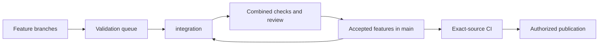

# Worktree development and integration

Use this workflow for concurrent feature work in the Paseo monorepo. Follow your shared agent
rules for ownership and approval. This guide covers the repository-specific environment,
validation, and integration steps.

## Fork branches and ownership

The fork is [RyanEwen/paseo-plus-plus](https://github.com/RyanEwen/paseo-plus-plus). Its default
branch is `main`. This development checkout keeps the fork and upstream remotes separate:

| Ref or remote                              | Role                                                                                 |
| ------------------------------------------ | ------------------------------------------------------------------------------------ |
| `fork`                                     | RyanEwen/paseo-plus-plus, the destination for fork work.                             |
| `origin`                                   | getpaseo/paseo, the upstream source. Fork work does not authorize upstream writes.   |
| `main`, tracking `fork/main`               | Accepted fork features and upstream updates; release source.                         |
| `integration`, tracking `fork/integration` | Long-lived combined testing branch for selected feature work.                        |
| `upstream/main`, tracking `origin/main`    | Local upstream mirror used to review upstream synchronization.                       |
| `fork/upstream/main`                       | Preserved upstream mirror in the fork repository. Its head can lag the local mirror. |
| Feature branches                           | Own each feature, its tests, documentation and follow-up fixes.                      |
| Temporary review branches                  | Optional bounded reviews before combination in `integration`.                        |

Inspect actual remote URLs and full heads when adopting a checkout. A ref's name does not prove
its destination or that two mirrors are synchronized. Do not retarget `origin` to make an inherited
upstream command operate on the fork.

Start each new feature from an explicitly resolved, freshly fetched `fork/main`, in its own branch
and workspace under the existing Paseo project, with one accountable owner. Resume that owner for
follow-up work. Record the base SHA and exact comparison ref; do not inherit unpublished work from
a local branch by accident. The app's starting-ref behavior is described in
[development](development.md#worktree-starting-refs).

Keep implementation and follow-up fixes on the owning feature branch. Merge selected feature
commits into `integration` to test them together. Resolve feature defects on their owning branches,
then bring those fixes into `integration`; record shared-file conflict resolutions with their owners.
Do not leave a feature fix only in the combined working tree or a private patch directory.

`integration` is long-lived. It can contain work that is not yet accepted for `main`. After combined
review and qualification, merge the accepted feature commits into `main`. Merge the resulting `main`
back into `integration` so release fixes and upstream updates remain available to ongoing work.
Do not merge all of `integration` into `main` while it contains unaccepted features.

Use the states below to distinguish prepared source, qualification, combination and publication.
A `review/*` branch is optional and temporary. Coordinate branch or workspace renames with active
owners, preserve unfinished work first, and keep paths stable when tools or evidence reference them.
A folder named `preview-distribution` does not select a release branch.

Legacy `ryan/preview` refs can still contain unpublished commits or serve existing workspace
comparison targets. Preserve those refs and their exact base SHAs until reviewed reconciliation
and explicit owner comparison-ref migration. Do not bulk-push their commits, prune them, rename
active workspaces, or silently replace their bases with `main`. Historical QA receipts retain the
branch names and source hashes that were actually qualified; they do not define today's workflow.

For upstream synchronization, inspect divergence and preserve both local and remote mirror heads
before an authorized mirror update. Keep fork changes out of the upstream mirror. Review the
upstream delta and integrate it into fork `main` through the same review and qualification process;
do not reset fork `main` to upstream. Review the
[fork overview](release.md#fork-overview-review) for additions that upstream now provides. A pure
mirror retains upstream's workflow source, so changing triggers on fork `main` does not enable
automatic CI on the mirror.

Release only the exact validated fork integration SHA through
[fork preview distribution](release.md#fork-preview-distribution). Temporary release coordination
is covered by [release branch discipline](release.md#release-branch-discipline). Published-owner
archival follows [released feature workspaces](release.md#released-feature-workspaces); it is
separate from source integration and review assembly.

## Work moves through explicit states

| State     | What is established                                                       | What remains                                 |
| --------- | ------------------------------------------------------------------------- | -------------------------------------------- |
| Prepared  | The owner has a reviewable source change and focused regression coverage. | Checks and runtime qualification.            |
| Qualified | The declared checks passed against a recorded source and environment.     | Integration with other changes.              |
| Assembled | The review preview contains the selected owner changes.                   | Combined checks and review.                  |
| Merged    | Authorized commits are integrated into the destination branch.            | Exact-source CI and packaging.               |
| Published | The authorized release and required assets are available and verified.    | Any explicitly unverified device acceptance. |

Record platform coverage separately. A browser pass does not qualify Android native code, and a
source fix does not change the running daemon. Packaging and device acceptance have different
prerequisites; follow [QA](qa.md) and the [release playbook](release.md).

## Qualify the environment before implementation

Paseo's configured `paseo.json` worktree setup installs the lockfile dependencies, seeds isolated
dev state, and builds the server stack. Inspect the setup before invoking it: directory adoption
and managed worktree creation have different setup behavior. When package installation is outside
the task's authorization, do not trigger a setup hook that runs `npm ci`.

Prepare the worktree once, with a recorded base commit, lockfile, toolchain, and dependency source.
Confirm the following before spending time on feature checks:

- Root dependencies and package-local dependencies resolve from the intended environment.
- Package aliases refer to the owning checkout; generated declarations match the producing source.
- Vite, TypeScript, and other writable caches have worktree-local destinations.
- Runtime qualification has the required browser or native SDK and generated project.

A bare root `node_modules` symlink is not a qualified environment. This repository also has
package-local overrides, including app and Expo module dependencies. Missing those entries can
produce missing-module errors while the root dependency tree appears populated. Shared writable
caches can also send Vite's temporary configuration output outside the owner's writable directory.

If you reuse prepared dependencies, treat the source tree as read-only. Keep writable caches and
build outputs local, reuse package-local entries as well as root entries, and verify compatibility
with the owner's lockfile and toolchain. Record any required physical copies from the qualified
source. Do not install packages or change shared dependencies as an unreported setup repair.

For missing generated types, rebuild the producer using the
[owning package targets](development.md#built-workspace-packages). Do not add duplicate types or
annotate callbacks to hide stale declarations. A missing Android SDK or generated native project
is an environment limitation, not a reason to claim a browser check qualifies Kotlin.

Directory adoption can register a worktree as a new project when the source project identity is
omitted. Record the canonical project ID and pass it explicitly when adopting a prepared Git
worktree into Paseo. Confirm the returned project and workspace IDs before launching its agent.

## Budget disk space and retain work deliberately

On WSL, check both Linux filesystem space and the Windows drive holding its virtual disk. Linux
can report a large remaining virtual capacity while the Windows drive is nearly full. See
[Microsoft's disk-space guide](https://learn.microsoft.com/en-us/windows/wsl/disk-space).

Measure source, installed dependencies, generated outputs, and saved evidence separately. Avoid
copying a complete installed dependency tree into every worktree when the dependency set is
unchanged. Reuse qualified immutable inputs and keep workspace-linked packages and writable
caches local. Cache reuse needs the lockfile, package patches, toolchain, and native ABI to match.

Container images and package caches do not make disk usage disappear. Reuse their immutable
layers without creating a separate dependency volume for every feature by default. A workspace
setup preflight should report expected disk growth and available host space before installing or
copying large trees.

Keep source and evidence retention separate from disposable build caches. Before cleanup, record
which directories are referenced by active workspaces, dependency links, and unfinished review or
release evidence. Present exact cleanup candidates and expected savings; do not broadly delete
`.dev` or dependency directories because their names look temporary.

[Workspace archive and recovery](agent-lifecycle.md#archive) have different guarantees from
retaining a source backup. Save unfinished work and verify its repository references before
archiving a managed worktree. Freeing Linux files and reclaiming space from the host virtual disk
are separate operations; do not interrupt running WSL services to compact the disk during work.

## Run checks through a visible queue

For this constrained WSL workflow, run one heavy validation operation at a time, using two CPUs
from the process's allowed CPU set. Owners can read source and prepare independent changes while
another owner holds the slot. A grant names the owner, allowed checks, and release condition.

Use the existing focused suites and real runtime fixtures described in [testing](testing.md).
Preserve failure logs before repairing the source or environment. Do not retry an unchanged
failure blindly, weaken assertions to get green, or rerun unchanged checks already reported green.
The full local suite remains outside this workflow; use CI for broad verification.

Each qualification handoff records:

- Branch, base commit, current commit, and the uncommitted patch or file hashes.
- Changed paths and any shared-file overlaps with other owners.
- Exact commands, results, logs, and runtime captures for the source that was checked.
- Platform limits, pending product decisions, and fixture teardown evidence.

Release the slot explicitly. Source preparation, a passing focused test, and a complete feature
qualification are separate outcomes; name the outcome that the evidence supports.

## Assemble a review preview deliberately

Use `integration` for the combined preview. Record which feature commits are included and which
remain unaccepted. A checkpoint of an existing mixed working tree preserves work during
reconciliation; it does not establish that its changes belong to clean feature branches. Retire
that exception by assigning and restoring the changes to their owners before promotion to `main`.

Keep the review preview separate from the running production daemon and its state. Use
[checkout-local dev homes and assigned service ports](development.md#running-the-dev-server) for
fixtures. A browser preview may connect to an existing daemon without controlling its lifecycle.

Take a snapshot before combining owner changes. Use the owner's recorded patch base when applying
a delta. Compare shared files such as `workspace-screen.tsx`, `left-sidebar.tsx`, locale resources,
and README against that base. Do not overwrite an assembled file with a whole older owner copy.
Resolve overlapping changes deliberately and keep the original owner patches available.

A live preview can refresh for user review. Qualification needs a frozen source: do not edit its
inputs while a browser or native case is running. Record the source identity alongside screenshots.

After assembly, run the required combined static checks and the integration cases justified by
changed interactions or resolved conflicts. Reuse unchanged owner results; do not call their
results proof of new integration behavior. Keep unqualified native changes visible in the status.

## Improve setup before increasing concurrency

Repeated missing-dependency repairs consume the validation queue and obscure source failures.
The next tooling improvement should be a repeatable worktree preflight, backed by the existing
setup and build targets, that records dependency provenance, local cache paths, generated outputs,
and available runtime prerequisites. It should fail with a specific missing prerequisite before
feature work starts. This guide documents that target; it does not claim the preflight exists.
